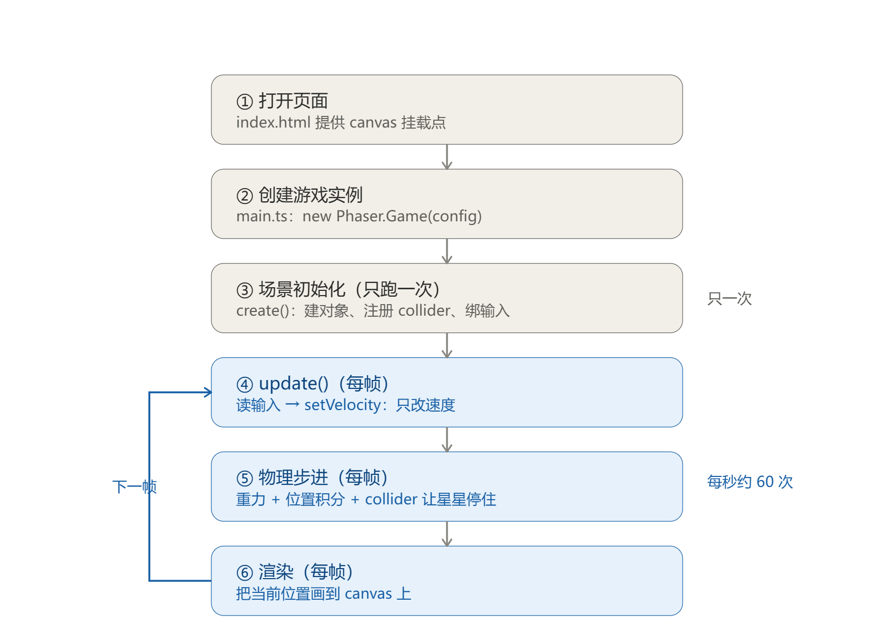

# Stage 00 学习笔记：从页面加载到角色能跳

> 学习路线：先用 Web（Phaser 3 + TypeScript）打通游戏编程的基本概念，再迁移到 Unity 2D。
> 本篇覆盖：项目结构与启动链路、场景生命周期、物理系统（重力 / 碰撞 / 积分）、DevTools 调试、版本管理。
> 全部结论均对照 `phaser@3.80` 源码 `src/physics/arcade/` 与 `demo1` 实测，非凭印象。

---

## 一、参考项目：一个 60 行的平台跳跃

`demo1` 是一个极简平台跳跃游戏，技术栈 Vite + TypeScript + Phaser 3：

- 一个平台（静态物理体），20 颗星星（可收集），一个方块玩家；
- 方向键左右移动，空格/上键跳跃，碰到星星加分，收集完切换场景。

它的价值不在玩法，而在于**用最少的代码跑通了"游戏"的完整回路**：加载 → 建场景 → 建对象 → 注册碰撞 → 每帧更新 → 物理推进 → 渲染。

### 文件结构

```
demo1/
├── index.html          # 唯一的 <div id="game-container">
├── src/
│   ├── main.ts         # 入口：new Phaser.Game(config)
│   └── scenes/
│       ├── BootScene.ts    # 启动场景（加载资源的地方）
│       ├── MenuScene.ts    # 菜单
│       └── GameScene.ts    # 真正的游戏逻辑
└── vite.config.ts      # 开发服务器与打包配置
```

---

## 二、启动链路：谁先跑，谁后跑

```
index.html
  └─ <script type="module" src="/src/main.ts">
       └─ new Phaser.Game(config)          ← 引擎实例，接管 canvas 与主循环
            ├─ 读 config.scene 数组，启动第一个：BootScene
            │    ├─ preload()  加载资源
            │    └─ create()   初始化 → this.scene.start("MenuScene")
            ├─ MenuScene.create() → this.scene.start("GameScene")
            └─ GameScene.create()  → 之后每帧调用 update()
```



三个容易混的点：

1. **`config.scene` 是「注册」，启动的是数组第 0 个。** 其余场景只是"登记在册"，被 `scene.start()` 点名才运行。
2. **`scene.start(key)` 会停止当前场景再启动目标场景**，它不是"叠加"，是"切换"。要叠加得用 `scene.launch()`。
3. **`extends` 的方向是「子类 → 父类」**：`class BootScene extends Phaser.Scene`，箭头从 `BootScene` 指向 `Phaser.Scene`。读法："BootScene 是一种 Phaser.Scene"。

### GameConfig 逐字段

```ts
const config: Phaser.Types.Core.GameConfig = {
  type: Phaser.AUTO,                 // 自动选渲染器：优先 WebGL，不支持则回退 Canvas
  width: 800,
  height: 600,
  parent: "game-container",          // 把引擎创建的 <canvas> 挂到指定 DOM 容器
  backgroundColor: "#1a1a2e",
  debug: false,                      // true 可看到碰撞盒轮廓与 FPS，调试必备
  physics: {
    default: "arcade",               // 用的是 Arcade 物理：AABB + 速度积分，轻量、够用
    arcade: {
      gravity: { x: 0, y: 400 },     // 世界重力加速度，单位 px/s²
      debug: false,                  // 物理层调试：画出 body 边框
    },
  },
  scene: [BootScene, MenuScene, GameScene],
};
```

> `gravity: { x: 0, y: 400 }` 的单位是**像素/秒²**，不是"每帧 400 像素"。这个区别是后面所有物理理解的起点。
> 另外注意：Phaser 的 y 轴**向下为正**，所以"向上"永远是负速度。

### 场景生命周期：`preload` → `create` → `update`

| 方法 | 调用次数 | 该干什么 |
| --- | --- | --- |
| `preload()` | 1 次 | 加载资源（图片/音频/字体/图集） |
| `create()` | 1 次 | 搭建舞台：建对象、注册输入、注册碰撞 |
| `update(time, delta)` | 每帧 | 读输入、改状态；`delta` 是上一帧耗时（毫秒） |

```ts
export default class GameScene extends Phaser.Scene {
  private player!: Phaser.Physics.Arcade.Sprite;   // 注意这个 !

  constructor() {
    super("GameScene");    // 必须：父类 Scene 的初始化（登记场景 key）
  }
}
```

两个 TypeScript 细节：

- **`super(key)` 必须调用**，否则父类没初始化，后续访问 `this.add` / `this.scene` 会崩。
- **`!` 是"明确赋值断言"**：告诉编译器"我保证用到它之前已经赋值了"。因为精灵只能在 `create()` 里创建，而字段声明在构造期就要过类型检查，不加 `!` 会报 "Property has no initializer"。
  > 它是**编译期语法糖，运行时完全不存在**——所以它永远不可能成为运行时 bug 的原因。

---

## 三、物理系统：三种东西，一条链路

Arcade 物理只做三件事：**给速度**（重力/你的代码）、**检测重叠**（collider）、**把速度积分成位置**。

### 3.1 静态体 vs 动态体

```ts
this.physics.add.existing(platform, true);   // 第二个参数 true = 静态体
```

源码里就一行判断：

```js
var type = (isStatic) ? CONST.STATIC_BODY : CONST.DYNAMIC_BODY;
```

| | 静态体（`true`） | 动态体（省略 / `false`） |
| --- | --- | --- |
| `allowGravity` | `false` | `true` |
| `immovable` | `true` | `false` |
| `moves`（是否参与逐帧积分） | `false` | `true` |
| 被别人推动 / 撞偏 | 不会 | 会（除非手动 `setImmovable(true)`） |
| 典型用途 | 地板、墙、平台 | 玩家、敌人、子弹、掉落物 |

**漏传 `true` 会发生什么**：平台变成动态体 → 受重力 400 下落 → 掉到画布底部（y≈600）被世界边界拦住 → 玩家原地悬空、跟着掉 → 整关报废。

> 口诀：**自己会动的用动态体，不动但需要被撞的用静态体。**

想让动态体"站稳不动"，两个开关都要关：

```ts
body.setAllowGravity(false);   // 只关重力，还是会被推
body.setImmovable(true);       // 再加上这个，才是"能站但不能动"
```

### 3.2 碰撞：能让物体停下来的只有三种东西

在 demo1 里，星星从空中落下，最后**停在平台表面**。用坐标可以反证是谁干的：

| 对象 | 参数 | 关键边 |
| --- | --- | --- |
| 平台 | `add.rectangle(400, 568, 800, 30)` | 中心 y=568，高 30 → **顶面 y≈553** |
| 世界边界 | 画布高 600 | 下沿 **y=600** |

如果只靠世界边界，星星会**穿过平台**掉到 y=600 才停——那时它已经在平台下方 47px、贴着屏幕底了。实际现象是停在平台表面，所以动手的只能是 `collider`。

```ts
this.physics.add.collider(this.player, platform);        // 玩家站地面
this.physics.add.collider(this.stars, platform);         // 星星落地面
this.physics.add.collider(this.player, this.stars, cb);  // 吃到星星触发回调
```

能让物体停住的三种机制：

1. **`collider`** —— 主力，负责落地、撞墙、堆叠；
2. **`collideWorldBounds`** —— 保险，只管场景四周；
3. **手写约束** —— 自己判条件把速度归零（后面调手感会大量用到）。

> 最该背下来的一句：**重力只负责加速，永远不会让东西停下来。**

**对照实验（实测过，值得自己做一遍）**：

| 操作 | 现象 |
| --- | --- |
| 注释掉 `collider(stars, platform)` | 星星穿过平台，落到画布底部 y≈600 |
| 再把星星组的 `collideWorldBounds` 设为 `false` | 星星直接掉出屏幕 |

### 3.3 谁把速度变成位置：引擎里的三行

`arcade/Body.js` 的 `update(delta)`：

```js
prev.set(pos.x, pos.y);                        // 记下本帧起点

if (!this.moves) {                             // moves = false 的 body 在这里直接返回
  this._dx = pos.x - prev.x;                   // （静态体根本不在 World 的积分列表里）
  return;
}

this.world.updateMotion(this, delta);           // 重力 → velocity.y += gravity.y * delta
this.newVelocity.set(vel.x * delta, vel.y * delta);
pos.add(this.newVelocity);                      // position += velocity * delta
```

三个关键点：

- `update()` 里**只改速度**，位置是引擎用速度乘 `delta` 积分出来的；
- 乘的是**本次步长的秒数**，不是"每帧多少像素"这样的常量——这个区别决定了游戏换台机器会不会变速；
- 顺序是"先更新速度，再用新速度算位移"，这叫**半隐式欧拉（semi-implicit Euler）**，比显式欧拉稳定，是游戏引擎的标准做法。

**一帧的完整顺序**（`World.update` 的真实次序）：

1. **`body.preUpdate(willStep, delta)`**：`resetFlags()` → `updateFromGameObject()`（精灵→body 同步）→ 存 `prev` → 需要步进时执行 `body.update(delta)` 积分
2. 建碰撞树（`tree.load(bodies)`，空间分区，避免两两全比）
3. 逐个 `collider` 检测 → **分离（separate）**：把重叠推开、清掉法向速度
4. **`postUpdate`**：把 `body.position` 写回精灵 —— 到这一步屏幕上的位置才改变

### 3.4 物理步长 ≠ 渲染帧长（一个容易搞错的前提）

直觉上会以为"物理用的是这一帧的 `delta`"。查 `World` 的构造会发现并不是：

```js
this.fps = GetValue(config, 'fps', 60);
this.fixedStep = GetValue(config, 'fixedStep', true);
this._frameTime = 1 / this.fps;                 // 1/60 s
this._frameTimeMS = 1000 * this._frameTime;     // 16.67 ms
```

`World.update` 用累加器决定这一步要不要推进：

```js
this._elapsed += delta;                          // delta = 渲染帧耗时，144Hz 下 ≈ 6.94ms
var willStep = (this._elapsed >= msPerFrame);    // 攒够 16.67ms 才步进
if (!this.fixedStep) { fixedDelta = delta * 0.001; willStep = true; }   // 只有关掉固定步长才用渲染 delta
```

所以在 demo1 里：**渲染 144fps，物理固定每秒 60 步**，平均 2.4 个渲染帧对应 1 次物理步进，`Body.update` 收到的 `delta` 恒为 `1/60 ≈ 0.0167s`。

还有一条：`stepsLastFrame = 1`，**一帧最多步进一次**。渲染掉到 30fps 时，物理会跟着"变慢"（每秒只跑 30 步）而不是追帧——这是 Arcade 稳定、但掉帧时会时间变慢的原因。

### 3.5 手算一次跳跃

demo1 参数：`v₀ = -400`（起跳速度），`g = 400`（重力），**物理步长 0.0167s**。

| 时刻 | `velocity.y` | 本次步进位移 |
| --- | --- | --- |
| 起跳那次步进 | `-400` | `-400 × 0.0167 ≈ -6.67px` |
| 下一次步进 | `-400 + 400 × 0.0167 ≈ -393.3` | `≈ -6.56px` |
| 顶点 | 由负变正的那次步进 | —— |

连续解：上升时间 `v₀/g = 1s`，最高 `v₀²/(2g) = 200px` —— 正好 60 次步进。

**帧率影不影响跳跃高度？** 要分两种情况：

| 情况 | 是否受帧率影响 | 说明 |
| --- | --- | --- |
| 变步长（自己写的 `x += v * dt` 循环） | **会**，帧率越低跳得略高 | 离散解 `h ≈ v₀²/(2g) + v₀·dt/2`；144Hz ≈ 201.4px，60Hz ≈ 203.3px，差约 2px（1%） |
| demo1（Phaser 默认 `fixedStep: true`） | **不会** | `dt` 恒为 1/60，跳跃高度恒为 ≈203.3px，与显示器刷新率无关 |

> 这个对比正是下一阶段的主线：把"渲染帧"和"物理步"分开，用累加器连接起来。

> 另一条通用原则：**和时间有关的量都必须乘 `delta`**。用"每帧加固定值"写移动逻辑，换一台机器速度就变。

### 3.6 想改位置？两个坑

**坑一：直接写 `sprite.x` 会被覆盖。**

```ts
update() {
  this.player.x = 500;   // 基本无效：帧初 body 会重新盖住它，还要过一遍碰撞分离
}
```

`preUpdate` 里的 `updateFromGameObject()` 会把精灵位置吃进 body，之后 body 的积分结果又在 `postUpdate` 写回来。想让位置修改生效，要用物理层的 API：

```ts
this.player.body!.reset(500, 300);   // 内部：清零速度 → setPosition → 同步 prev
```

`reset(x, y)` 一次做三件事：精灵与 body 对齐、`prev` 同步（不会拉出一条假位移）、速度清零。

**坑二：瞬移不能靠"把速度调得很大"。**

速度大只代表"走得快"，路上遇到 collider 依然会被挡住；而且速度会一直保留，下一帧继续飞。要瞬移就用 `reset`。

---

## 四、调试：别用断点测帧率

### 4.1 断点和时间的关系

- 一帧跑一次 `update()`，`F10`（单步）只在**同一帧内部**走一行；
- 这帧走完，物理推进还没发生、下一帧还没来，所以 `velocity` 看起来"纹丝不动"；
- 想看跨帧变化，必须 `F8`（继续）让它跑到下一个断点；
- **断点会让程序停住几秒，`delta` 直接失真**——用断点测帧率等于用体温计测身高。

### 4.2 怎么测帧率（实测数据）

在 `update()` 里累计计数，每秒打一次：

```ts
private frameCount = 0;
private lastReport = performance.now();

update() {
  this.frameCount++;
  const now = performance.now();
  if (now - this.lastReport >= 1000) {
    console.log("过去 1 秒游戏运行了", this.frameCount, "帧");
    this.frameCount = 0;
    this.lastReport = now;
  }
}
```

实测（144Hz 显示器）：

```
过去 1 秒游戏运行了 145 帧
过去 1 秒游戏运行了 142 帧
过去 1 秒游戏运行了 143 帧
过去 1 秒游戏运行了 144 帧
过去 1 秒游戏运行了 145 帧
过去 1 秒游戏运行了 143 帧
过去 1 秒游戏运行了 144 帧
过去 1 秒游戏运行了 144 帧
```

结论：**帧率天花板由显示器刷新率决定**，因为 `requestAnimationFrame` 与垂直同步绑定。波动 142–145 是正常的调度抖动。

更省事的办法：Phaser 已经算好了 —— `this.game.loop.actualFps`。

### 4.3 怎么读调用栈（Call Stack）

三步：

1. **最上面一行** = 我现在停在哪（断点所在函数）；
2. **往下扫，找到第一个自己写的函数** = 谁把我叫来的，找到就停；
3. 中间那一堆引擎内部帧（`Step` / `TimeStep` / `emit` …）**全部忽略**。

看到栈底出现 `TimeStep.step` 这件事本身就是答案：`update` 是被"时间步进"驱动的，所以它绑在刷新率上——这正是上面 144 帧的成因。

### 4.4 报错怎么定位

故意写错一个属性名（`this.playr`），控制台会给出 `文件:行:列`，点进去直接跳到源码行（Vite 的 sourcemap 让 TS 原文件可读）。排查顺序：先看报错行 → 再看这一行的对象是不是 `undefined` → 顺着调用栈往上找"谁把它变成 undefined 的"。

---

## 五、两个元技能（工具层面）

### 5.1 版本管理：只需要五条命令

```bash
git status                 # 现在改了哪些文件
git add -A                 # 全部加入暂存区
git commit -m "说明"        # 提交
git push                   # 推到远程
git checkout -- 文件路径    # 丢弃某个文件的改动（改坏了用它）
```

学习期真正救命的只有最后一条：**敢改代码的前提是"改坏了能回去"**。

### 5.2 用 AI 辅助学习的正确姿势

- **让 AI 出题、做 code review、解释源码**，而不是让它写你要学的核心逻辑；
- 提问模板：*"我卡在 X 的 Y 处，我的理解是 Z（先自己答），我试过改 W，期望效果是 V，给提示不要给答案。"* —— 先说自己的猜测，AI 才能指出错在哪；
- AI 给的结论要用源码/实测复核（本篇的 `preUpdate` 顺序、`reset` 行为都是查源码确认的，本篇也曾把重力误记成 300，实际配置是 400）。

---

## 六、速查表

| 想做的事 | 用什么 |
| --- | --- |
| 加载资源 | `preload()` |
| 初始化场景 | `create()` |
| 每帧逻辑 | `update(time, delta)` |
| 切换场景 | `this.scene.start(key)` |
| 平台 / 墙 | `physics.add.existing(obj, true)` |
| 玩家 / 敌人 | `physics.add.sprite()`（默认动态体） |
| 落地 / 碰撞 | `physics.add.collider(a, b, cb)` |
| 改速度 | `setVelocityX/Y()` |
| 改位置（瞬移） | `body.reset(x, y)` |
| 站地检测 | `body.blocked.down` |
| 看当前帧率 | `this.game.loop.actualFps` |
| 看碰撞盒 | `arcade.debug: true` |

## 七、易错点清单

1. **y 轴向下为正**：`velocity.y > 0` 是下落，`-400` 才是起跳。
2. **重力单位是 px/s²**，不是 px/帧。
3. **`gravity` 只加不减**：能让物体停下的是 collider / 世界边界 / 手写约束。
4. **别用断点测帧率**，`delta` 会失真；用计数 + `performance.now()`。
5. **`!` 是编译期断言**，运行时不存在，永远不是 bug 的原因。
6. **直接写 `sprite.x` 结果不可控**：帧初被 body 吸收、之后又被碰撞分离修正，位置类操作走 `body.reset`。
7. **静态体漏传 `true`** → 平台会掉下去。
8. **`scene.start()` 是切换不是叠加**。
9. **`extends` 箭头从子类指向父类**。
10. **瞬移 ≠ 调大速度**：速度大只是快，还会被 collider 拦。

## 八、留给下一个阶段的问题

Phaser 已经替我们做了"固定步长"，但它还有一个明显的取舍没解决：**一帧最多步进一次**。于是：

- 掉帧时物理会"变慢"（30fps 时每秒只跑 30 步），时间被拉长。要"追上真实时间"该怎么写？（`while` 追帧 + 单帧步数上限 + 剩余时间的处理）
- 渲染 144fps、物理 60 步，画面会不会出现"位置跳格"？插值（`lerp(prev, curr, alpha)`）如何消掉它？
- 固定步长下 `alpha` 到底怎么算？为什么它必须落在 `[0, 1)`？
- `delta` 在标签页切走再回来时会突然变得很大，处理成 clamp 还是丢弃？
- 可变跳跃高度、土狼时间、跳跃缓冲——这些手感优化分别落在输入层 / 状态层 / 物理层的哪一层？

这五个问题正好是下一个 Stage 的主线：**游戏循环与时间**。
